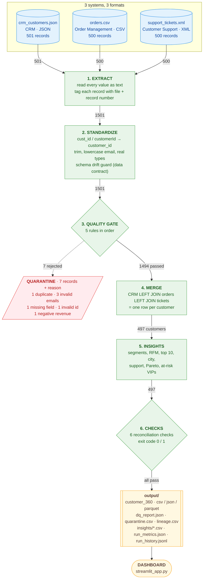
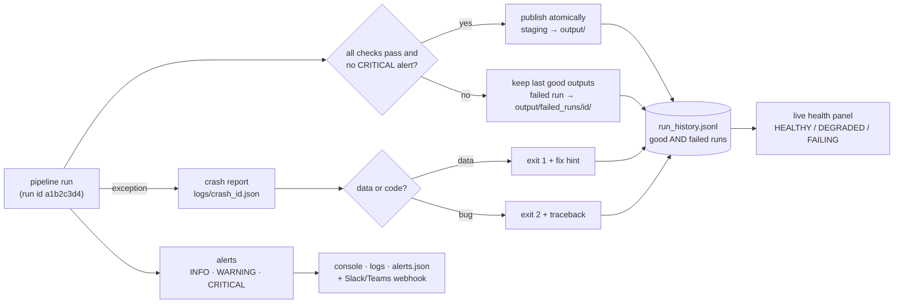

# Customer 360: one trusted view of every customer


**Live dashboard:** https://customer360-pipeline-gft7qijsnafy8u2tz4gyqz.streamlit.app/

Github: https://github.com/rkaran112/customer360-pipeline/tree/main


An e-commerce company keeps customer data in three separate systems: **CRM** (JSON),
**Order Management** (CSV) and **Customer Support** (XML). Each system was built on its own,
so the same customer id is called `customer_id`, `cust_id` or `customerId`, and nobody can see
a customer's profile, spending and complaints together.

This project is a **data pipeline** that:
1. loads all three files,
2. gives them one common schema,
3. checks data quality (and quarantines bad records with a reason),
4. merges everything into **one row per customer** (the "Customer 360"),
5. produces business insights,
6. proves nothing was lost.

A **Streamlit dashboard** shows the results, including a live picture of the pipeline itself.

| | |
|---|---|
| Input | 1,501 records from 3 files (501 CRM + 500 orders + 500 tickets) |
| Data quality | 7 bad records caught and quarantined, 1,494 passed, **DQ score 99.53%** |
| Output | 497 customers in `customer_360` (CSV + JSON + Parquet) + 12 insight tables |
| Run time | under 1 second for the whole pipeline |
| Tests | 97 test functions = **129 test cases**, all passing, 99% code coverage, CI on Windows and Linux |
| Reliability | graded alerts + webhook, crash reports, retries, last-known-good publishing, **13 chaos scenarios**, live health panel |

---

## 1. Run it

**Option A — step by step** (Python 3.11, 3.12 or 3.13; tested on all three)

1. Get the code. Either clone it, or download the ZIP from GitHub (**Code → Download ZIP**) and unzip it.
   ```bash
   git clone https://github.com/rkaran112/customer360-pipeline.git
   ```
   ```bash
   cd customer360-pipeline
   ```
2. Create a private Python environment (`.venv`), so these libraries don't change your other projects.
   ```bash
   python -m venv .venv
   ```
   Then **activate** it:

   | Your terminal | Command |
   |---|---|
   | Windows PowerShell | `.venv\Scripts\Activate.ps1` |
   | Windows Command Prompt | `.venv\Scripts\activate.bat` |
   | macOS / Linux | `source .venv/bin/activate` |

   The prompt now starts with `(.venv)`. On Windows, if `python` is not found, use `py -3` instead.
3. Install the pinned libraries (about 1–2 minutes the first time):
   ```bash
   pip install -r requirements.txt
   ```
4. Run the pipeline. It ends with `FINISHED OK` and exit code 0 (about 1 second):
   ```bash
   python run_pipeline.py
   ```
5. Open the dashboard. A browser tab opens at http://localhost:8501; press `Ctrl+C` in the terminal to stop it:
   ```bash
   streamlit run streamlit_app.py
   ```

**Troubleshooting**

| Problem | Fix |
|---|---|
| PowerShell: "running scripts is disabled" when activating | `Set-ExecutionPolicy -Scope CurrentUser RemoteSigned`, then activate again |
| `pip install` fails with a "long path" error on Windows | the folder path is too deep (e.g. inside OneDrive). Move the project to a short path such as `D:\customer360`, delete `.venv`, and repeat from step 2 |
| `streamlit` is not recognised | the environment is not active: run the activate command from step 2 |
| Port 8501 already in use | `streamlit run streamlit_app.py --server.port 8502` |
| The pipeline prints `PIPELINE FAILED` | read the `hint:` line; full details are in the crash report it names (see "Exit codes" below) |

**Option B — double-click** `run.bat` on Windows. It creates its own `.venv`, installs everything,
runs the pipeline and opens the dashboard. Close the window to stop it.

**Option C — Docker** (same result on any machine):
```bash
docker build -t customer360 .
```
```bash
docker run -p 8501:8501 customer360
```
Then open http://localhost:8501.

**Option D — online:** open the live dashboard link at the top. The pipeline runs inside the
app, and you can **upload your own three files** from the sidebar to run it on new data.

### Deploying to Streamlit Community Cloud (free, about 3 minutes)
1. Sign in at **share.streamlit.io** with the GitHub account that owns this repo.
2. Click **Create app**, then **Deploy a public app from GitHub**.
3. Repository `rkaran112/customer360-pipeline`, branch `main`, main file path `streamlit_app.py`.
4. **Advanced settings**, then **Python 3.12** (CI tests 3.12 and 3.13).
5. Click **Deploy**. The first build installs `requirements.txt` (about 2–3 minutes).

Why nothing else is needed:
- **No build step:** the app runs the pipeline itself on first load, and `output/` is rebuilt
  automatically (it is not in git).
- **Auto-redeploy:** every push to `main` redeploys the app.
- **Shared server:** all visitors share one server process, so a lock stops two first visitors
  from writing `output/` at the same time.
- **Tested from a fresh clone:** the deploy path was checked by cloning the public repo into an
  empty folder, installing the pinned `requirements.txt`, and cold-starting the server.

Things to know:
- **Sleep:** a free app sleeps after a period with no visitors. Opening the link wakes it in under a minute.
- **Run history resets:** the server's disk is temporary, so the run-history chart starts fresh
  after a restart. All other outputs rebuild automatically.
- **Uploads:** uploaded files are processed in a temporary folder and are never saved to the repo
  (the limit is 50 MB, set in `.streamlit/config.toml`).
- **After a push:** the server can keep old copies of `pipeline/` modules in memory. The app
  detects this and re-imports the current code by itself. If the page ever names a "wrong
  run_pipeline module", use **Manage app** (bottom right) → **⋮** → **Reboot app**.

**Run the tests** (in the activated environment; 129 tests, about 2–3 minutes because 13 of them are chaos scenarios):
```bash
pip install -r requirements-dev.txt
```
```bash
pytest
```

**Command-line options:**
```bash
python run_pipeline.py --input-dir D:/new_files --output-dir D:/results --config config.json --log-level DEBUG
```

| Exit code | Meaning | Who fixes it |
|---|---|---|
| `0` | success, outputs published | nobody |
| `1` | **data problem**: missing or broken file, schema drift, a CRITICAL alert or a failed check. The last good outputs are kept | the source team (fix the input) |
| `2` | **code problem**: an unexpected error, i.e. a bug. A crash report is written | the developers (fix the code) |

Schedulers such as cron, Airflow and GitHub Actions read this number to know whether a run
failed, and which kind of failure it was.

**Run the chaos tests** (break things on purpose, prove recovery):
```bash
python chaos_test.py
```

**Send alerts to Slack / Teams / Discord:** set the webhook URL in an environment variable
before running. It is never stored in code or config, because a webhook URL is a secret.

| Your terminal | Command |
|---|---|
| Windows PowerShell | `$env:C360_ALERT_WEBHOOK = "https://hooks.slack.com/services/XXX"` |
| Windows Command Prompt | `set C360_ALERT_WEBHOOK=https://hooks.slack.com/services/XXX` |
| macOS / Linux | `export C360_ALERT_WEBHOOK=https://hooks.slack.com/services/XXX` |

On Streamlit Cloud, add `C360_ALERT_WEBHOOK = "https://..."` under **App settings → Secrets**.
Without a webhook, alerts still appear in the console, the logs, `output/alerts.json` and the dashboard.

---

## 2. How it works (the picture)



| Stage | File | What happens | Rows in → out |
|---|---|---|---|
| 1 Extract | `pipeline/extract.py` | Reads JSON, CSV and XML. The reader is picked by the `format` in config. Every value is kept as **text**, so loading can never crash. `_source` and `_source_row` are added for lineage. | 1501 → 1501 |
| 2 Standardize | `pipeline/standardize.py` | Renames columns to one schema. Trims spaces, lowercases emails, title-cases cities, converts numbers and dates. Checks the columns against the data contract. **Never removes rows.** | 1501 → 1501 |
| 3 Quality gate | `pipeline/quality.py` | Runs 5 rules in order. The first rule a record breaks is its reason. Failed records go to quarantine. Builds `dq_report.json`. | 1501 → 1494 (+7 quarantined) |
| 4 Merge | `pipeline/merge.py` | CRM left join orders left join tickets on `customer_id`. Customers without orders or tickets are kept and flagged. | 1494 records → 497 customers |
| 5 Insights | `pipeline/insights.py` | Adds segment, RFM, average order value and recency. Builds 12 report tables and headline sentences. | 497 → 497 |
| 6 Checks | `pipeline/checks.py` | Proves the run is correct. Any failure gives exit code 1. | 497 → published |

`run_pipeline.py` only connects the steps, times them and writes the outputs.

---

## 3. Requirements

### Functional requirements — *what* the system does
| ID | Requirement | Implemented in |
|---|---|---|
| FR-1 | Load CRM (JSON), Orders (CSV) and Support (XML); the reader is picked by format in config | `extract.py` |
| FR-2 | Rename source columns to one schema (`cust_id`, `customerId` → `customer_id`) | `standardize.py` |
| FR-3 | Clean values: trim, lowercase email, title-case city, typed numbers and dates | `standardize.py` |
| FR-4 | Detect duplicates, invalid emails, missing mandatory fields, negative revenue and invalid customer ids | `quality.py` |
| FR-5 | Quarantine failed records with source, record number, rule and detail; never delete silently | `quality.py` |
| FR-6 | `dq_report.json` with the brief's keys, plus per-rule and per-source counts | `quality.py` |
| FR-7 | Reconcile: total = all failures + successful, otherwise the run fails | `quality.py`, `checks.py` |
| FR-8 | Customer 360: one row per customer, left join on `customer_id`; CSV + JSON + Parquet | `merge.py`, `outputs.py` |
| FR-9 | Insights: top 10 by revenue, Gold/Silver/Bronze, >5 tickets, revenue and customers by city | `insights.py` |
| FR-10 | Extra analytics: RFM, Pareto, support vs value, cohorts, city scorecard, at-risk VIPs, unhappy high-value | `insights.py` |
| FR-11 | Dashboard: live pipeline diagram, lineage tracer, analytics, data quality, customer lookup | `streamlit_app.py`, `diagram.py` |
| FR-12 | Upload your own 3 files in the dashboard and rerun the pipeline; download the results | `streamlit_app.py` |
| FR-13 | Record stage metrics (rows in/out, rejected, ms) and a run history | `run_pipeline.py`, `outputs.py` |
| FR-14 | Schema drift guard: compare arriving columns with the config "data contract" | `standardize.py` |
| FR-15 | Graded alerts (INFO/WARNING/CRITICAL) on quarantine counts and rates, empty sources, drift, volume change, DQ drop, failed checks; optional webhook | `alerts.py` |
| FR-16 | On failure: a clear message with stage + fix hint, a crash report, exit code 1 (data) or 2 (bug) | `diagnostics.py`, `run_pipeline.py` |
| FR-17 | Chaos testing: 13 injected faults, each verified for the right reaction and for recovery (CLI + dashboard) | `chaos.py`, `chaos_test.py` |
| FR-18 | Live pipeline health: status, success rate, freshness, durations, last failure (auto-refresh) | `health.py`, `streamlit_app.py` |

### Non-functional requirements — *how well* it does it
| ID | Quality | How it is met |
|---|---|---|
| NFR-1 | **Executable** | One command, `run.bat` double-click, Docker image, live URL |
| NFR-2 | **Configurable** | Sources, column mappings, mandatory fields, regex patterns, thresholds and as-of date all live in `config.json`; a new JSON/CSV/XML source needs **no code** |
| NFR-3 | **Scalable** | Every stage is a function: table in, table out, no hidden state; readers and rules are registries; see section 10 |
| NFR-4 | **Reliable** | Reconciliation, 6 checks, `validate="one_to_one"` joins, last-known-good publishing, retry with backoff, failure isolation (a dead webhook never stops a run); proven by 13 chaos scenarios |
| NFR-5 | **Reproducible / idempotent** | "Today" comes from the data, not the clock; duplicates resolved in a stable order; the same input gives byte-identical output (tested) |
| NFR-6 | **Observable** | Run id on every log line; text log + JSON log (`pipeline.jsonl`) with rotation; DEBUG mode; per-stage metrics; run history of good AND failed runs; live health panel; alerts; lineage for every record |
| NFR-7 | **Testable** | 81 test cases, each with a "why", in CI on 2 operating systems × 2 Python versions |
| NFR-8 | **Fast** | Under 1 s for 1,501 records; the dashboard caches the run per set of input files |
| NFR-9 | **Maintainable** | A plain-English comment on every block, `>>> TO CHANGE:` markers, small single-purpose functions |
| NFR-10 | **Privacy** | No emails in insight reports; emails masked on screen (`am***@gmail.com`) |
| NFR-11 | **Portable** | Windows, Linux and Docker; pinned `requirements.txt` |

---

## 4. What was wrong in the data (and what happens to it)

I profiled every file before writing pipeline code. These are the actual defects:

| File | Record | Problem | Caught by | What happens |
|---|---|---|---|---|
| crm_customers.json | 501 | C0105 sent a second time (exact copy) | `duplicates` | first copy kept, second quarantined |
| crm_customers.json | 125, 250, 375 | email without `@` (`user125example.com`) | `invalid_emails` | customer quarantined (D-05) |
| orders.csv | 310 | C0310 `total_orders` is blank | `missing_fields` | order quarantined; C0310 stays in the 360 as "No order data" |
| orders.csv | 420 | C0420 `lifetime_value = -5000` | `negative_revenue` | order quarantined; C0420 shows "No order data" |
| support_tickets.xml | 450 | empty `<customerId />` | `invalid_customer_ids` | quarantined; C0450 has no ticket data |

The resulting `dq_report.json` (the first 5 keys are the brief's format):
```json
{
  "total_records": 1501,
  "duplicates": 1,
  "invalid_emails": 3,
  "missing_fields": 1,
  "successful_records": 1494,
  "invalid_customer_ids": 1,
  "negative_revenue": 1,
  "quarantined_records": 7,
  "dq_score_pct": 99.53,
  "by_source": { "crm": {"dq_score_pct": 99.2, ...}, "orders": {...}, "tickets": {...} },
  "referential_integrity": { "orders_without_customer": 3, "tickets_without_customer": 3, ... },
  "reconciled": true
}
```
*Orphans:* the orders and tickets of the 3 customers whose CRM record was quarantined have no
customer to attach to. They are **counted and reported**, never hidden.

---

## 5. Features that go beyond the brief

1. **Live pipeline diagram.** The Pipeline tab draws every stage with the real rows in/out
   and milliseconds from the last run, plus the quarantine branch. It is drawn from
   `run_metrics.json`, so it can never disagree with what actually ran.
2. **Record lineage tracer.** Pick any customer to see their journey through every file:
   *"orders.csv record 420 → extracted → standardized → QUARANTINED (negative revenue)"*.
   It answers "why is this customer missing?" in one click.
3. **Upload and run.** Upload three new files in the sidebar and the whole pipeline runs on
   them in the browser, quality report included.
4. **Schema drift guard.** An unexpected column gives a warning; a missing mandatory column stops the run
   with a clear message.
5. **DQ score per source system.** Shows which upstream team sends the dirtiest data.
6. **Run history.** Every run appends its DQ score and duration to `run_history.jsonl`; the
   dashboard charts the trend.
7. **Advanced analytics:**
   - **RFM segmentation:** Champions / Loyal / Promising / At risk / Hibernating, each with a recommended action.
   - **Pareto curve:** how concentrated revenue is.
   - **Support vs value:** a scatter plot and a correlation.
   - **Registration cohorts** and a **city scorecard**.
   - **At-risk VIPs:** Gold/Silver customers with no order for 90+ days.
   - **Unhappy high-value customers:** Gold customers with more than 5 tickets.
8. **Headline findings computed from the data**, never typed by hand. For example: *"293 Gold/Silver
   customers have not ordered for 90+ days: Rs 4.29 crore of lifetime value at risk."*
9. **Customer lookup.** Search by id or name to get one customer's 360° card, with the email masked.
10. **Downloads.** customer_360 (CSV/JSON), dq_report.json and quarantine.csv from the sidebar.

---

## 5b. Reliability: logging, alerts, crash help, chaos tests, live health

**What happens when a run goes wrong:**


**1. Logging** (`pipeline/logger.py`)
- **Run id:** every line carries the run id (`2026-11-06 14:39:08 | WARNING | fc33eba4 | ...`).
- **Two log files:**
  - `logs/pipeline.log` is for people.
  - `logs/pipeline.jsonl` has one JSON object per line, for log tools such as ELK, Splunk or
    CloudWatch, including fields like `stage`, `source` and `alert_code`.
- **Rotation:** files rotate at 5 MB, keeping 5 old ones, so logs never fill a disk.
- **Debug mode:** `--log-level DEBUG` adds column types, missing-value counts and up to 3
  example rows per failing rule.

**2. Alerts** (`pipeline/alerts.py`, limits in `config.json → alerts`)

| Alert | Severity | Fires when | On today's data |
|---|---|---|---|
| `QUARANTINE_RATE` | WARNING ≥ 0.5%, CRITICAL ≥ 5% | share of a source's records quarantined | **WARNING**: crm 0.8% (4 of 501) |
| `RULE_FAILURES` | INFO | any rule rejected rows, with the count | 5 alerts (3 invalid emails, 1 duplicate, ...) |
| `EMPTY_SOURCE` | CRITICAL | a source sent 0 records | – |
| `SCHEMA_DRIFT` | WARNING | unexpected columns | – |
| `VOLUME_CHANGE` | WARNING | records ±50% vs the last good run (half-sent files) | – |
| `DQ_SCORE_DROP` | WARNING | DQ score fell ≥ 1 point vs the last good run | – |
| `ORPHAN_RECORDS` | INFO | orders/tickets with no clean customer | 6 records |
| `CHECK_FAILED` | CRITICAL | any step-6 check fails | – |
| `PIPELINE_FAILED` | CRITICAL | the run crashed or stopped on a data error | – |

Where alerts appear:
- **Always:** the console, the logs, `output/alerts.json`, and the dashboard (a banner, plus the Data Quality tab).
- **Optionally:** a **webhook** (Slack, Teams, Discord or any HTTP endpoint) for WARNING and above.
- **A CRITICAL alert fails the run** (exit 1), so bad data is never published as a success.

**3. Crash help** (`pipeline/diagnostics.py`)

A failure prints what broke, where, and how to fix it:
```
PIPELINE FAILED (DATA PROBLEM) in stage 'Extract': source 'crm': input file not found: ...
  hint:         Check input_dir in config.json (or --input-dir) and the file names under input_sources.
  crash report: logs/crash_175f1902.json
  exit code:    1
```

The crash report holds:
- the stage, the error and the full traceback;
- the **exact command to reproduce** the run in DEBUG mode;
- library versions and the config used;
- a **fingerprint of every input file** (size, md5, line count, modified time).

The fingerprint proves whether a file changed since the last good run. The report never
contains file contents, so no personal data leaks into tickets.

**4. Self-recovery**
- **Retry with backoff:** a temporarily locked file is retried after 0.2 s, then 0.4 s. Each
  retry is counted in the run history.
- **Last-known-good publishing:** a healthy run writes to `output/.staging` and then moves each
  file into place, so readers never see a half-written file. An unhealthy run goes to
  `output/failed_runs/<run_id>/`, and the good outputs stay untouched.
- **Automatic recovery:** the next run with good data is published as normal, with no manual cleanup.
- **Failure isolation:** a dead webhook, a half-written history line or one bad row never stops the run.

**5. Chaos tests** (`pipeline/chaos.py`, `python chaos_test.py`, dashboard → **🧪 Chaos Lab**)

Each scenario works in a private sandbox copy of the data:
1. Run a good **baseline**.
2. **Inject one fault**, then check the exit code, the expected alert or error, that the
   last good outputs are untouched, the history entry and the crash report.
3. **Remove the fault** and confirm the next run succeeds (= recovery).

| Scenario | Fault injected | Expected | Protection |
|---|---|---|---|
| `baseline` | none (control) | exit 0 | normal run |
| `corrupt_json` | CRM file cut in half | exit 1 | stops at Extract, names file + line |
| `missing_file` | orders.csv absent | exit 1 | names the missing file |
| `drop_mandatory_column` | `lifetime_value` removed | exit 1 | schema drift guard |
| `extra_column` | unknown column added | exit 0 + WARNING | column ignored, run continues |
| `empty_source` | 0 tickets | exit 1 + CRITICAL | not published |
| `bad_row_spike` | 20% negative revenue | exit 1 + CRITICAL | quarantined, not published |
| `duplicate_flood` | 10 CRM rows resent | exit 0 + WARNING | duplicates quarantined |
| `partial_export` | only 40% of orders | exit 0 + WARNING | volume change detected |
| `bad_encoding` | orders.csv as UTF-16 | exit 1 | "not UTF-8" hint |
| `flaky_disk` | file locked for 2 reads | exit 0 | retry with backoff |
| `webhook_down` | Slack unreachable | exit 0 | failure logged, run unaffected |
| `code_crash` | bug inside merge | exit 2 | crash report with traceback |

**6. Live pipeline health** (`pipeline/health.py`, dashboard → strip at the top + **❤️ Pipeline Health** tab)

The health status comes from the run history and refreshes **every 5 seconds**:
- **HEALTHY:** the last run was good and raised no warnings.
- **DEGRADED:** the last run raised warnings, a recent run failed and the pipeline has since
  recovered, or the data is stale (no good run in 26 hours).
- **FAILING:** the last run failed.

The tab also shows:
- the success rate over the last 20 runs;
- hours since the last good run;
- average and slowest duration;
- a timeline with failed runs in red, and the DQ score per run;
- the last failure with its fix hint and crash report;
- a **Run now** button.

---

## 6. Decision log — every choice, and why

Each decision lists: **what** was decided, the **options** considered, **why** this option,
the **trade-off**, and **how to change it** if someone asks.

**D-01 · pandas (not DuckDB or Spark) for the transformations**
- **Options:** pandas, DuckDB SQL, PySpark.
- **Why:** 1,500 records fit in memory a thousand times over. pandas is the easiest to read line by
  line, and it reads JSON, CSV and XML directly.
- **Trade-off:** pandas uses a single machine. Every stage is a pure function, so moving to
  DuckDB or Spark only changes function bodies, not the design (section 10).
- **Change:** rewrite one stage file; `run_pipeline.py` and the tests stay.

**D-02 · Configuration-driven (`config.json`)**
- **Options:** hard-coded values, environment variables, a config file.
- **Why:** sources, column mappings, mandatory fields, regex patterns and thresholds change for business reasons.
  With a config file, those changes need no code. This is the brief's "brownie point" feature.
- **Trade-off:** one more file to read.
- **Change:** edit `config.json`. `test_changing_gold_threshold_in_config_changes_segments` proves it works.

**D-03 · Rules run in a fixed order; the first broken rule is the reason**
- **Options:** count every rule a record breaks, or count only the first.
- **Why:** each record is counted exactly once, so the report always adds up
  (total = failures + successful). The order runs from most basic to most specific:
  invalid id → duplicate → missing field → invalid email → negative revenue.
- **Trade-off:** a record that breaks two rules shows only the first reason.
- **Change:** reorder the `RULES` list in `quality.py`.

**D-04 · Quarantine bad records; never delete or silently fix them**
- **Why:** deleting hides problems from the source team, and guessing a fix (for example a missing
  `@`) can create wrong data. Quarantine keeps every record, with the rule, the detail, the file
  and the record number.
- **Change:** `quarantine.csv` can be re-fed after the source fixes it.

**D-05 · An invalid email quarantines the CRM record** *(choice agreed for this project)*
- **Options:** quarantine the record, or keep the customer with a blank email and a flag.
- **Why:** this matches the brief's report arithmetic (successful = total − duplicates −
  invalid emails − missing fields), and the email is a mandatory contact field.
- **Trade-off:** 3 customers' revenue is left out of the analytics until their emails are fixed.
- **Change:** remove `invalid_emails` from `RULES` and flag the email instead.

**D-06 · CRM is the master; LEFT JOIN orders and tickets**
- **Why:** only the CRM has name, email and city, so it defines who a customer is. A LEFT JOIN
  keeps customers who have no orders or tickets. An INNER join would silently drop them.
  `validate="one_to_one"` makes pandas fail instead of multiplying rows if a duplicate slips through.
- **Change:** `merge.py`, one line per join.

**D-07 · Customers without order data get the segment "No order data", not Bronze**
- **Why:** C0310's order says Rs 1.22 lakh but its order count is missing, so the record was
  rejected. Calling C0310 a low-value Bronze customer would be a wrong business message.
  The `has_order_data` and `has_ticket_data` flags keep "zero" and "unknown" apart.
- **Change:** `segment_customers()` in `insights.py`.

**D-08 · Zero revenue is allowed, negative revenue is rejected**
- **Why:** a newly registered customer can have 0. A negative lifetime value is impossible.
- **Change:** `rule_negative_revenue` in `quality.py`.

**D-09 · For duplicates, keep the first copy**
- **Why:** the files have no `updated_at` column, so there is no way to know which copy is newer.
  "First" is stable and repeatable. (If an `updated_at` is added, keep the newest instead.)
- **Change:** `rule_duplicates` in `quality.py`.

**D-10 · A blank customer id counts as an invalid id, not a missing field**
- **Why:** the brief lists "invalid customer IDs" as its own challenge, and the id rule runs first.
  A record without a usable id can never be joined.
- **Change:** order of `RULES`.

**D-11 · "Today" comes from the data, not the computer clock**
- **Why:** "days since last order" based on the real date would change every day, so reruns and
  tests would give different numbers. `as_of_date` in config, or the latest date in the
  data (2026-10-28), keeps every run reproducible.
- **Change:** set `"as_of_date": "2026-11-06"` in config.json.

**D-12 · Segment boundaries: Gold > 100000, Silver 50000–100000, Bronze < 50000**
- **Why:** taken from the brief. Exactly 100000 is **Silver**, because the brief says Gold is
  *more than* 100000. Boundary tests lock this in.
- **Change:** `config.json` → `segments`.

**D-13 · "More than 5 tickets" is strict (6 or more)**
- **Change:** `config.json` → `insights.high_ticket_threshold`.

**D-14 · RFM scores by thirds (tertiles) using rank-percent**
- **Why:** the scores adapt to any data size or spread, and work with even 1 customer. Fixed cut
  points would need re-tuning every time.
- **Change:** `tertile_score()` and `rfm_label()` in `insights.py`.

**D-15 · The 360 is written in three formats**
- **Why:** CSV for people and Excel, JSON for the brief's format and APIs, Parquet for analytics
  tools (compressed, typed, and fast for Spark, Power BI and warehouses).

**D-16 · The dashboard runs the pipeline itself (cached)**
- **Why:** the deployed app works from a fresh copy of the code with no pre-built files, and
  users can upload new files. A fingerprint of the input files decides when to rerun.
- **Trade-off:** the first page load runs the pipeline (under 1 second here).

**D-17 · Privacy: no emails in reports, emails masked on screen**
- **Why:** an email is personal data, and dashboards are widely shared. The full email exists
  only in the customer_360 export, for systems that need it.

**D-18 · Simple run metrics and run history instead of Airflow**
- **Why:** this is a single job on one machine. A scheduler would add setup without adding
  value. The exit code and `run_metrics.json` are exactly what Airflow would consume later.

**D-19 · Schema drift: warn on an extra column, stop on a missing mandatory column**
- **Why:** a new extra column is harmless, so the business keeps running. A missing
  `lifetime_value` would make every revenue number wrong, so it is better to stop loudly.

**D-20 · Deployed on Streamlit Community Cloud, with Docker as well**
- **Why:** Streamlit Cloud is free and deploys straight from GitHub, so every push redeploys.
  Docker covers any other server or cloud.

**D-21 · Last-known-good publishing (a failed run never overwrites good outputs)**
- **Options:** always overwrite, or publish only healthy runs.
- **Why:** dashboards and downstream systems keep yesterday's correct numbers instead of today's
  broken ones. Staging plus a file move means nobody ever reads a half-written file.
- **Trade-off:** after a failure, the published data is one run old. The health panel makes that visible.

**D-22 · Two failure exit codes: 1 = data, 2 = code**
- **Why:** it tells on-call *who* to call (the source team or the developers) before anyone opens a log.

**D-23 · CRITICAL alerts fail the run; WARNING and INFO do not**
- **Why:** a few bad rows are normal (quarantine handles them). A 5%+ spike or an empty file means
  the source is broken. Limits live in config, and `fail_on` can be changed.
- **Trade-off:** thresholds need tuning per source over time.

**D-24 · Alert webhook URL in an environment variable, and a webhook failure never stops a run**
- **Why:** a webhook URL is a secret (anyone holding it can post to your channel). A Slack outage
  must not stop the data.

**D-25 · Retry only transient errors (locked file), not broken content**
- **Why:** reading a broken JSON file again gives the same error; retrying it would only hide the
  real problem and waste time. 3 attempts with exponential backoff, set in config.

**D-26 · JSON logs alongside text logs, with a run id on every line**
- **Why:** people read text; log platforms search JSON. The run id ties together the logs,
  history, alerts and crash report of one run.

**D-27 · Chaos tests run in a sandbox, in CI and in the dashboard**
- **Why:** failure handling that is never exercised usually doesn't work. A sandbox means a
  public visitor can break things safely.

---

## 7. Tests — what each one checks and why

Run them with `pytest` (129 test cases from 97 test functions, 99% coverage). Most tests use **tiny
hand-made files** in a temporary folder. That means they never depend on an earlier run,
each one shows exactly the defect it is about, and they never touch the real `output/`.

**Why these kinds of tests?**
- **Unit tests** tell you *which* rule broke.
- **Boundary tests** catch off-by-one business rules (100000 Silver or Gold?).
- **End-to-end tests** catch wiring mistakes between steps.
- **Idempotency tests** prove a rerun is safe.
- **Dashboard tests** prove the demo page opens.

| # | Test | What it checks | Why it matters |
|---|---|---|---|
| **Extract** | `tests/test_extract.py` | | |
| 1 | `test_json_loads_all_records_and_columns` | JSON rows and columns load | CRM is the master customer list |
| 2 | `test_csv_keeps_every_value_as_text` | `N/A` and `0012` stay text | a bad value must not crash the load |
| 3 | `test_xml_empty_tag_becomes_empty_text` | `<customerId />` → `''` | the exact defect in record 450 |
| 4 | `test_unknown_format_raises_clear_error` | `jsn` typo → clear error | config mistakes must be obvious |
| 5 | `test_missing_file_names_the_file` | error names `orders.csv` | the on-call person knows what to fix |
| 6–8 | `test_empty_file_gives_zero_rows_not_crash` ×3 | empty JSON/CSV/XML → 0 rows | quiet days happen |
| 9 | `test_tracking_columns_added` | `_source`, `_source_row` = 1,2,3 | powers lineage and quarantine |
| **Standardize** | `tests/test_standardize.py` | | |
| 10 | `test_different_id_names_become_customer_id` | `cust_id`/`customerId` → `customer_id` | the merge needs one key |
| 11 | `test_email_lowercased_city_titlecased_spaces_trimmed` | `" mumbai "` → `Mumbai` | otherwise city totals split |
| 12 | `test_bad_numbers_become_missing_not_crash` | `abc`, `2.5` orders → missing | step 3 reports them instead |
| 13 | `test_dates_parse_and_invalid_dates_become_missing` | `2026-13-45` → missing | date maths needs real dates |
| 14 | `test_extra_column_gives_warning_and_continues` | new column → warning | harmless changes don't stop the business |
| 15 | `test_missing_mandatory_column_stops_the_run` | no `lifetime_value` → error | revenue without revenue data is wrong |
| 16 | `test_standardize_never_removes_rows` | row counts unchanged | removing rows is step 3's job, where it's counted |
| **Quality** | `tests/test_quality.py` | | |
| 17 | `test_duplicate_keeps_first_and_quarantines_second` | first copy kept | duplicates double-count customers |
| 18–22 | `test_invalid_emails_are_rejected` ×5 | `user.com`, `a@b`, `@x.com`, spaces, the real defect | unreachable customers |
| 23–25 | `test_valid_emails_pass` ×3 | `a.b+1@x.co.in`, capitals, hyphens pass | a too-strict rule rejects good customers |
| 26 | `test_missing_mandatory_field_is_rejected` | blank `total_orders` named in detail | the brief's "missing values" |
| 27 | `test_negative_revenue_rejected_but_zero_allowed` | −5000 rejected, 0 allowed | negative LTV is impossible |
| 28–32 | `test_invalid_customer_ids_are_rejected` ×5 | blank, `C12`, `X0001`, `c0001`, `C00001` | an unjoinable id |
| 33 | `test_id_with_spaces_is_trimmed_and_passes` | `" C0001 "` passes | spaces are a slip, not a wrong id |
| 34 | `test_first_broken_rule_wins_and_counts_once` | bad id + bad email = 1 failure | the report must add up |
| 35 | `test_two_blank_ids_are_not_also_duplicates` | 2 invalid ids, 0 duplicates | proves the rule order works |
| 36 | `test_every_quarantined_row_has_reason_source_and_record` | no blank reasons | the source team must be able to fix it |
| 37 | `test_clean_and_quarantine_split_every_row_exactly_once` | no overlap, no loss | the core "nothing lost" guarantee |
| 38 | `test_report_has_every_key_from_the_brief` | 5 brief keys present | the output contract |
| 39 | `test_report_reconciles` | total = failures + successful | no record vanished |
| 40 | `test_reconcile_detects_a_broken_count` | a broken count → False | the safety check itself can fail |
| 41 | `test_dq_score_per_source` | 3/4 passed = 75% | finds the dirtiest system |
| **Merge** | `tests/test_merge.py` | | |
| 42 | `test_one_row_per_customer` | unique `customer_id` | a duplicate doubles revenue |
| 43 | `test_customer_without_orders_is_kept_and_flagged` | left join keeps them | an inner join drops customers silently |
| 44 | `test_customer_without_tickets_is_kept` | 0 tickets, flag False | no complaints is normal |
| 45 | `test_orphan_orders_are_counted_not_merged` | C0099 counted as an orphan | visible, not hidden |
| 46 | `test_output_has_the_brief_columns` | the brief's column order | the output contract |
| 47 | `test_brief_example_record_matches` | C0001 = brief's example values | proves the merge on known data |
| 48 | `test_revenue_is_conserved` | 380000 in = 380000 out | joins must not create or lose money |
| **Insights** | `tests/test_insights.py` | | |
| 49–53 | `test_segment_boundaries` ×5 | 100001 Gold, 100000 Silver, 50000 Silver, 49999 Bronze, 0 Bronze | off-by-one is the top business-rule bug |
| 54 | `test_no_order_data_segment` | unknown ≠ Bronze | don't guess value |
| 55 | `test_top_customers_sorted_and_limited` | max 10, sorted, works with 2 | the brief's revenue ranking |
| 56 | `test_more_than_5_tickets_is_strict` | 5 excluded, 6 included | "more than 5" |
| 57 | `test_city_totals_add_up` | city sums = totals | regional = overall |
| 58 | `test_rfm_scores_and_one_label_each` | scores 1–3, one label | every customer gets an action |
| 59 | `test_pareto_share_bounds` | 0–100, 100 for one customer | a percent outside 0–100 is a bug |
| 60 | `test_as_of_date_comes_from_config_not_the_clock` | 20 days exactly | reproducible results |
| 61 | `test_at_risk_vips_use_the_day_threshold` | only the old Gold order | no false alarms on a call list |
| 62 | `test_average_order_value_never_divides_by_zero` | 0 orders → empty | new customers have 0 orders |
| 63 | `test_headlines_are_computed_from_data` | sentences use data values | hand-typed findings go stale |
| 64–66 | `test_email_masking` ×3 | `am***@gmail.com`, `***` | privacy on screens |
| 67 | `test_inr_formatting` | lakh / crore | the business reads money in lakh/crore |
| **Config** | `tests/test_config.py` | | |
| 68 | `test_real_config_loads_with_all_sections` | all sections and 3 sources | broken config caught first |
| 69 | `test_config_missing_section_fails_clearly` | names `segments` | fail fast, not a KeyError later |
| 70 | `test_changing_gold_threshold_in_config_changes_segments` | 120000 → Silver at 150000 | proves "config driven" |
| **End to end** | `tests/test_end_to_end.py` (real files) | | |
| 71 | `test_exact_dq_numbers_on_real_data` | 1501 / 1 / 3 / 1 / 1 / 1 / 1494 | every planted defect caught |
| 72 | `test_all_checks_pass_on_real_data` | 6 checks green, 497 customers | release gate |
| 73 | `test_all_output_files_exist_and_are_not_empty` | 11 files written | downstream users depend on them |
| 74 | `test_rerun_gives_identical_results` | byte-identical 360 | idempotent = safe reruns |
| 75 | `test_stage_counts_flow_into_each_other` | out of one = in of next | diagram numbers are consistent |
| 76 | `test_lineage_explains_every_record` | 1501 lineage rows; C0420 reason | "why is X missing" is answerable |
| 77 | `test_cli_exit_code_zero_on_success` | exit 0 | schedulers read exit codes |
| 78 | `test_cli_exit_code_one_on_missing_file` | exit 1 + names the file | failures must be visible |
| 79 | `test_failed_check_gives_exit_code_one` | broken reconcile → 1 | wrong numbers never published as success |
| **Dashboard** | `tests/test_dashboard.py` | | |
| 80 | `test_app_runs_without_errors_and_has_all_tabs` | 9 tabs, no exception | a broken demo is the worst failure |
| 81 | `test_customer_lookup_shows_the_customer` | C0001 card, masked email | the core "360" feature |
| 82 | `test_chaos_lab_runs_a_scenario_from_the_dashboard` | button runs a scenario, ✅ result | the live recovery demo must work |
| **Alerts** | `tests/test_alerts.py` | | |
| 83 | `test_quarantine_rate_warning` | 1% → WARNING | look before it gets worse |
| 84 | `test_quarantine_rate_critical` | 10% → CRITICAL | the upstream system is broken |
| 85 | `test_low_quarantine_rate_gives_no_rate_alert` | 0.2% → no alert | alert fatigue makes people ignore alerts |
| 86 | `test_each_failing_rule_gives_an_info_alert_with_count` | "3 record(s) failed invalid_emails" | counts per problem type |
| 87 | `test_empty_source_is_critical` | 0 records → CRITICAL | an empty export is a failure |
| 88 | `test_schema_drift_is_a_warning` | new column → WARNING | the data contract changed |
| 89 | `test_volume_change_vs_previous_run` | −60% → WARNING | catches half-sent files |
| 90 | `test_no_previous_run_means_no_comparison_alerts` | first run: no comparisons | nothing to compare with |
| 91 | `test_dq_score_drop_vs_previous_run` | 99.5 → 97 → WARNING | an early warning sign |
| 92 | `test_failed_check_is_critical` | failed check → CRITICAL | numbers untrustworthy |
| 93 | `test_alerts_sorted_worst_first` | CRITICAL first | the important line is read first |
| 94 | `test_webhook_receives_warning_and_critical_only` | local HTTP server gets WARNING+ in Slack/Discord format | chat stays readable |
| 95 | `test_no_webhook_configured_means_nothing_sent` | no env var → no network | works offline |
| 96 | `test_unreachable_webhook_never_raises` | dead URL → logged | Slack outage ≠ pipeline outage |
| 97 | `test_critical_alert_fails_the_run_and_blocks_publishing` | exit 1, output kept in failed_runs/ | bad data never looks like success |
| **Crash, logging, recovery** | `tests/test_diagnostics.py` | | |
| 98 | `test_code_crash_gives_exit_2_and_full_crash_report` | stage, traceback, md5s, reproduce cmd | debug without re-running |
| 99 | `test_broken_json_gives_exit_1_naming_file_and_line` | file + line in the message | the fix is in the data |
| 100 | `test_crash_report_contains_no_personal_data` | no names or emails | reports get shared in tickets |
| 101 | `test_failed_runs_are_recorded_in_history` | ok=False + status | health needs failures too |
| 102 | `test_last_good_outputs_survive_a_failed_run` | byte-identical 360 | a bad day doesn't wipe good data |
| 103 | `test_json_log_lines_have_run_id` | valid JSON, run id, stage | log tools filter by run |
| 104 | `test_log_files_rotate` | 2 rotating handlers | never fill a disk |
| 105 | `test_debug_level_logs_extra_detail` | types and examples in DEBUG | faster bug hunting |
| 106 | `test_transient_lock_is_retried_and_succeeds` | 3rd attempt works | hiccups heal by themselves |
| 107 | `test_retry_gives_up_with_clear_error` | gives up after N, with a hint | don't retry forever |
| 108–110 | `test_every_error_gets_a_hint` ×3 | specific advice / "bug" | tell on-call what to do |
| **Health + chaos** | `tests/test_health_and_chaos.py` | | |
| 111 | `test_no_runs_is_unknown` | UNKNOWN | never claim healthy without evidence |
| 112 | `test_clean_runs_are_healthy` | HEALTHY, 100% | baseline |
| 113 | `test_warning_alerts_make_it_degraded` | DEGRADED | working, but look |
| 114 | `test_last_run_failed_is_failing` | FAILING + reason | first thing on-call sees |
| 115 | `test_recovered_after_failure_is_degraded_not_healthy` | DEGRADED, 50% | recent instability matters |
| 116 | `test_stale_data_is_flagged` | 30 h → stale | a silently stopped pipeline looks green otherwise |
| 117–129 | `test_chaos_scenario_is_handled_and_recovers` ×13 | every fault: right exit, signal, kept outputs, recovery | proves failure handling for real |

CI (`.github/workflows/ci.yml`) runs the pipeline and every test on **Windows + Linux ×
Python 3.12 + 3.13** on every push, with a coverage report.

---

## 8. Outputs

| File | Grain (one row per…) | What it is for |
|---|---|---|
| `output/customer_360.csv/.json/.parquet` | customer | the unified dataset: brief columns + `has_order_data`, `has_ticket_data`, `segment`, `avg_order_value`, `days_since_last_order`, `days_since_last_ticket`, `high_ticket_customer`, `rfm_r/f/m`, `rfm_label` |
| `output/dq_report.json` | run | data-quality report (brief format + extras) |
| `output/quarantine.csv` | rejected record | source, record number, customer_id, rule, detail |
| `output/lineage.csv` | input record | file, record number, status (MERGED / QUARANTINED / ORPHAN) |
| `output/run_metrics.json` | stage | rows in/out/rejected, ms, checks |
| `output/run_history.jsonl` | run (appended) | DQ score and duration trend |
| `output/insights/top_customers.csv` | customer (10) | top 10 by revenue |
| `output/insights/segment_summary.csv` | segment | Gold/Silver/Bronze counts, revenue and shares |
| `output/insights/high_ticket_customers.csv` | customer | more than 5 tickets |
| `output/insights/revenue_by_city.csv`, `customers_by_city.csv`, `city_scorecard.csv` | city | regional analytics |
| `output/insights/rfm_summary.csv` | RFM group | size, revenue, action |
| `output/insights/at_risk_vips.csv`, `unhappy_high_value.csv` | customer | action lists |
| `output/insights/pareto_curve.csv`, `support_vs_value.csv`, `registration_cohorts.csv` | point / segment / month | analytics |
| `output/insights/headlines.json` | sentence | computed findings |
| `logs/pipeline.log` | log line | what happened in each run |

---

## 9. How to change things (search for `>>> TO CHANGE` in the code)

| If you're asked to… | Do this |
|---|---|
| change the Gold/Silver limits | `config.json` → `segments` (no code) |
| change "more than 5 tickets" or "90 days at risk" | `config.json` → `insights` (no code) |
| add a new **source** in JSON/CSV/XML | add an entry to `config.json` → `input_sources` with file, format, `column_mapping` and `mandatory_fields`; add its columns in `merge.py` |
| support a new **file format** (e.g. Excel) | write `read_excel()` in `extract.py` and add one line to `READERS` |
| add a **data-quality rule** (e.g. registration date in the future) | write `rule_xxx()` in `quality.py` and add one line to `RULES`; add the key to the report |
| make a field mandatory | add it to that source's `mandatory_fields` in `config.json` |
| keep customers with a bad email instead of quarantining them | remove the `invalid_emails` line from `RULES`; flag the email in `standardize.py` |
| add a **KPI / insight** | write a function in `insights.py` and add one line to `INSIGHTS` (it is exported automatically); add a chart in `streamlit_app.py` |
| add a **check** | append one tuple in `checks.py` |
| add a **segment tier** (Platinum) | one condition in `segment_customers()` + a threshold in config |
| change the email or id format | regex in `config.json` → `quality` |
| fix "today" to a date | `config.json` → `as_of_date` |

After any change, run `python run_pipeline.py` and then `pytest`.

---

## 10. Scaling: what changes at 100× and 10,000×

The **design stays the same**: extract → standardize → quality gate → merge → insights →
checks, with config, quarantine, reconciliation and lineage. Only the engine changes.

| Size | What I'd change |
|---|---|
| **Today** (~1.5 K records) | pandas, single run, under 1 s |
| **100×** (~150 K) | still pandas, or DuckDB SQL inside the same functions; Parquet input; partition outputs by date |
| **10,000×** (~15 M+) | PySpark or a cloud warehouse (BigQuery/Snowflake/Redshift) running the same steps as SQL/dbt models; files land in S3/ADLS; Airflow schedules the run and reads the exit code; incremental loads (only new or changed files, keyed by a file log); `MERGE` upserts instead of full rebuilds |
| **Real-time** | orders and tickets as Kafka events; the 360 profile updated per event; the same rules as streaming filters |

Why it scales:
- Every stage is a **pure function** (a table in, a table out, no hidden state).
- Readers and rules are **registries**, so adding one never touches existing code.
- All business values live in **config**.

---

## 11. Limitations and next steps (stated up front)

**Limitations:**
- **Full rebuild every run.** There is no incremental load. That is fine at this size; at scale, add a
  processed-file log and upserts.
- **Duplicates keep the first copy.** With an `updated_at` column the pipeline should keep the newest.
- **Customer history is not kept.** A changed city overwrites the old one. Next step: **SCD Type 2**
  (keep every version with valid-from and valid-to dates).
- **The dashboard's run history lives on the server's disk.** On Streamlit Cloud it resets when the app restarts.

**Next steps, in order of value:**
1. **Data contracts with the source teams**, so schema changes are agreed, not discovered.
2. **Alerting** on DQ score drops and volume changes. The run history already has the numbers.
3. **Fuzzy duplicate detection.** Today only an exact repeated id is caught; the same email under two ids would get through.
4. **Feed quarantine fixes back automatically.**

---

## 12. Glossary (plain words)

- **Pipeline:** a fixed series of steps that data passes through, like an assembly line.
- **ETL / ELT:** Extract, Transform, Load. This project extracts, transforms in Python, then loads (writes) the outputs.
- **Schema:** the list of columns and their types. "Standardize the schema" means everyone uses the same column names.
- **Data quality rule:** a test every record must pass, for example "the email contains @".
- **Quarantine:** a holding area for records that failed a rule, kept with the reason.
- **Reconciliation:** proving the counts add up, so no record was lost or invented.
- **Customer 360:** everything about one customer (profile, orders, support) in one row.
- **LEFT JOIN:** keep every row from the left table (CRM), and attach matching rows from the right table if any exist.
- **Orphan:** a record that points to a customer who doesn't exist in the clean customer list.
- **Idempotent:** running it twice gives the same result, so a rerun is always safe.
- **Lineage:** where a piece of data came from and what happened to it on the way.
- **Schema drift:** a source file suddenly arrives with different columns.
- **Segmentation:** splitting customers into groups (Gold/Silver/Bronze) to treat them differently.
- **RFM:** Recency (how recently they bought), Frequency (how often), Monetary (how much).
- **Pareto / 80-20:** checking whether a small share of customers brings most of the money.
- **Parquet:** a compressed, column-based file format that analytics tools read very fast.
- **Exit code:** the number a program returns when it ends. 0 means OK, anything else means failed.
- **CI:** Continuous Integration. Tests run automatically on every push.
- **Alert / webhook:** an automatic message when something needs attention; a webhook is a URL that receives it (for example a Slack channel).
- **Chaos testing:** breaking a system on purpose to prove it fails safely and recovers.
- **Last-known-good:** keep the previous correct output when a new run fails.
- **Backoff:** waiting a little longer before each retry (0.2 s, then 0.4 s).
- **Crash report:** a file with everything needed to debug a failed run.
- **Pipeline health:** whether the pipeline is running correctly right now (HEALTHY / DEGRADED / FAILING).

---

## Project layout
```
config.json            every setting (sources, rules, thresholds)
run_pipeline.py        one command: steps 1-6, alerts, publish, crash handling, exit 0/1/2
chaos_test.py          13 chaos scenarios from the command line
streamlit_app.py       dashboard (9 tabs incl. live health + chaos lab), runs the pipeline itself
pipeline/
  config.py            loads config.json
  logger.py            text + JSON logs with run id, rotation
  alerts.py            graded alerts + webhook
  diagnostics.py       crash reports, fix hints, data-vs-bug classification
  health.py            HEALTHY / DEGRADED / FAILING from the run history
  chaos.py             fault injectors + recovery verification
  extract.py           STEP 1
  standardize.py       STEP 2
  quality.py           STEP 3
  merge.py             STEP 4
  insights.py          STEP 5
  checks.py            STEP 6
  outputs.py           writes output/
  diagram.py           pipeline picture for the dashboard
  privacy.py           email masking
tests/                 129 test cases
data/raw/              the 3 source files from the brief
run.bat, Dockerfile, .github/workflows/ci.yml, requirements*.txt
```
